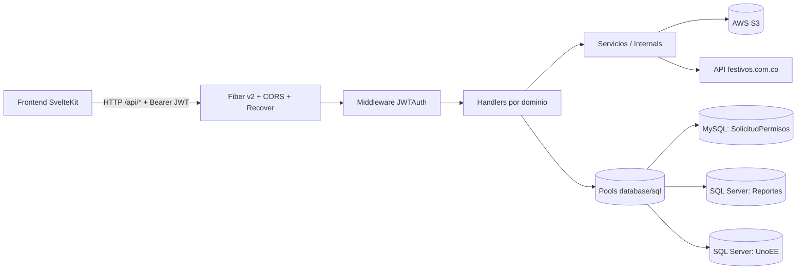

# Documentación Técnica – Backend

API REST para el sistema de **solicitud de permisos laborales** (`solicitud-permisos`). Desarrollada en **Go 1.24** con **Fiber v2**, persiste solicitudes, anuncios, fechas habilitadas y cierres en **MySQL**, consulta información de operadores y empleados en dos instancias de **SQL Server** (`Reportes` y `UnoEE`), almacena archivos adjuntos en **AWS S3** y valida días festivos mediante la API de **festivos.com.co**.

---

## Índice

1. [Stack](#1-stack)
2. [Arquitectura](#2-arquitectura)
3. [Estructura de carpetas](#3-estructura-de-carpetas)
4. [Principios SOLID y separación de responsabilidades](#4-principios-solid-y-separación-de-responsabilidades)
5. [Endpoints](#5-endpoints)
6. [Servicios y procesos internos](#6-servicios-y-procesos-internos)
7. [Modelo de datos](#7-modelo-de-datos)
8. [Autenticación y autorización](#8-autenticación-y-autorización)
9. [Variables de entorno](#9-variables-de-entorno)
10. [Comandos](#10-comandos)
11. [Despliegue](#11-despliegue)
12. [Puntos de mejora y riesgos](#12-puntos-de-mejora-y-riesgos)

---

## 1. Stack

| Tecnología | Versión / Paquete | Uso |
|---|---|---|
| Go | `1.24` (`time/tzdata` embebido) | Runtime y compilación binaria |
| Fiber | `github.com/gofiber/fiber/v2` (`v2.52.0`) | Servidor HTTP, enrutamiento, CORS, logger y recovery |
| JWT | `github.com/golang-jwt/jwt/v5` (`v5.2.0`) | Generación y validación de tokens Bearer (HS256) |
| MySQL Driver | `github.com/go-sql-driver/mysql` (`v1.8.1`) | Acceso a la base transaccional `SolicitudPermisos` |
| SQL Server Driver | `github.com/microsoft/go-mssqldb` (`v1.7.0`) | Consultas a `Reportes` y `UnoEE` (solo lectura) |
| AWS SDK Go v2 | `aws-sdk-go-v2/service/s3` (`v1.101.0`) | Carga de adjuntos, documentos de anuncios y *presigned URLs* |
| godotenv | `github.com/joho/godotenv` (`v1.5.1`) | Carga de variables desde `.env` |
| API Festivos | `https://www.festivos.com.co/api/v1` | Consulta de festivos en Colombia (con caché anual en memoria) |

---

## 2. Arquitectura



### Flujo de capas

1. **Entrada HTTP (`cmd/main.go`)**: Configura límite de cuerpo en **60 MB**, middlewares globales (`recover`, `logger`, `cors`), rutas públicas y grupo `/api` protegido por `middleware.JWTAuth()`.
2. **Handlers (`handlers/`)**: Reciben la petición Fiber, parsean JSON o `multipart/form-data`, ejecutan la lógica de negocio y consultan las bases de datos.
3. **Servicios e Internals (`services/`, `internal/`)**: Encapsulan integraciones externas (S3, API de festivos) y la carga tipada de configuración.
4. **Datos (`db/`)**: Administra tres pools `*sql.DB` (`MaxOpenConns: 10`, `MaxIdleConns: 5`, `ConnMaxLifetime: 5m`) inicializados al arranque y cerrados al finalizar `main`.

---

## 3. Estructura de carpetas

```text
backend/
├── go.mod
├── go.sum
├── cmd/
│   ├── main.go                    # Punto de entrada, Fiber, rutas, cron y arranque
│   └── inspect_solicitudes/
│       └── main.go                # Utilidad CLI de inspección de solicitudes
├── db/
│   └── db.go                      # Pools MySQL y SQL Server + migraciones de arranque
├── internal/
│   ├── config/
│   │   └── config.go              # Carga y validación de variables de entorno
│   └── holidays/
│       └── holidays.go            # Cliente HTTP y caché en memoria para festivos
├── middleware/
│   └── auth.go                    # Middleware JWTAuth (Bearer token)
├── models/
│   └── models.go                  # DTOs de petición/respuesta y entidades
├── handlers/
│   ├── auth.go                    # Login multi-fuente, /me y listado de empleados
│   ├── permisos.go                # Tipos, creación de permisos, extemporáneos y archivos
│   ├── solicitudes.go             # Listado, gestión, respuestas rápidas y estadísticas
│   ├── anuncios.go                # CRUD de anuncios de video, vistas y documentos
│   └── fechas.go                  # Fechas habilitadas, config de switch, cierres y cron
├── services/
│   └── s3.go                      # Cliente AWS S3 (upload, GetObject, presigned URLs)
├── sql/
│   ├── anuncios.sql               # DDL de anuncios_video y anuncios_vistas
│   ├── cierre_solicitudes.sql     # DDL de cierre_solicitudes
│   ├── fechas_config.sql          # DDL e inserts iniciales de fechas_config
│   ├── fechas_solicitudes.sql     # DDL de fechas_solicitudes
│   └── alter_fechas_area.sql      # Script de migración para columna area
└── utils/
    ├── jwt.go                     # GenerateToken y ValidateToken (HS256)
    └── utils.go                   # Utilidades generales (generación de strings aleatorios)
```

---

## 4. Principios SOLID y separación de responsabilidades

| Principio | Aplicación en el proyecto |
|---|---|
| **S** (Responsabilidad única) | Cada paquete y archivo atiende un dominio: `auth.go`, `permisos.go`, `solicitudes.go`, `anuncios.go`, `fechas.go`, `services/s3.go`, `internal/holidays/holidays.go`. |
| **O** (Abierto/Cerrado) | Nuevos endpoints o áreas se agregan registrando rutas o normalizando áreas sin alterar la infraestructura de autenticación o conexión. |
| **L / I** (Sustitución / Segregación) | Uso de `*sql.DB` estándar para múltiples motores y DTOs específicos por caso de uso (`CreatePermisoRequest`, `CreateExtemporaneoRequest`, `ResponderSolicitudRequest`). |
| **D** (Inversión de dependencias) | La configuración se inyecta en `db.InitDatabases(cfg)`, `services.InitS3(cfg.S3)` y `holidays.InitService(cfg.FestivosAPIKey)` desde `main.go`. |

---

## 5. Endpoints

CORS configurado con `AllowOrigins: "*"`, `AllowHeaders: "Origin, Content-Type, Accept, Authorization"`, `AllowMethods: "GET, POST, PUT, DELETE, OPTIONS"`.

### Rutas públicas

| Método | Ruta | Handler | Descripción |
|---|---|---|---|
| `GET` | `/health` | Inline | *Health check*: `{ "status": "ok" }` |
| `POST` | `/api/auth/login` | `handlers.Login` | Autenticación y emisión de JWT |
| `GET` | `/api/public/anuncios/:id/documento` | `handlers.GetDocumentoAnuncio` | Descarga/visualización pública del documento adjunto de un anuncio |

### Rutas protegidas (`/api/*` con `middleware.JWTAuth()`)

#### Usuario y Empleados

| Método | Ruta | Handler | Descripción |
|---|---|---|---|
| `GET` | `/api/me` | `handlers.Me` | Devuelve datos del usuario autenticado desde los claims/consulta |
| `GET` | `/api/empleados` | `handlers.ListEmpleados` | Lista empleados (para formularios administrativos/extemporáneos) |

#### Permisos y Archivos

| Método | Ruta | Handler | Descripción |
|---|---|---|---|
| `GET` | `/api/permisos/tipos` | `handlers.GetPermisosTipos` | Catálogo de tipos de novedad y subpolíticas |
| `POST` | `/api/permisos/crear` | `handlers.CreatePermiso` | Crea solicitud de permiso (con soporte para adjuntos en S3) |
| `POST` | `/api/permisos/extemporaneo` | `handlers.CreateExtemporaneo` | Crea permiso extemporáneo |
| `GET` | `/api/permisos/:id/archivos` | `handlers.GetArchivosPermiso` | Lista archivos asociados a una solicitud |
| `GET` | `/api/permisos/:id/archivo/:index` | `handlers.GetArchivoUrl` | Obtiene URL firmada o recurso del archivo por índice |

#### Solicitudes y Administración

| Método | Ruta | Handler | Descripción |
|---|---|---|---|
| `GET` | `/api/solicitudes/listar` | `handlers.ListSolicitudes` | Solicitudes del usuario autenticado |
| `GET` | `/api/solicitudes/todas` | `handlers.ListAllSolicitudes` | Listado global de solicitudes |
| `GET` | `/api/solicitudes/pendientes` | `handlers.ListSolicitudesPendientes` | Pendientes con conteo por área (`operaciones`, `mantenimiento`, `via-vigilantes`) |
| `GET` | `/api/solicitudes/recientes` | `handlers.GetSolicitudesRecientes` | Solicitudes gestionadas recientemente |
| `GET` | `/api/solicitudes/historial/:cedula` | `handlers.GetHistorialByCedula` | Historial de solicitudes de un empleado |
| `GET` | `/api/solicitudes/respuestas-rapidas` | `handlers.ListRespuestasRapidas` | Lista plantillas de respuestas rápidas |
| `POST` | `/api/solicitudes/respuestas-rapidas` | `handlers.CrearRespuestaRapida` | Crea una plantilla de respuesta rápida |
| `PUT` | `/api/solicitudes/:id/responder` | `handlers.ResponderSolicitud` | Aprueba o rechaza una solicitud con respuesta |
| `DELETE` | `/api/solicitudes/:id` | `handlers.EliminarSolicitud` | Elimina una solicitud por ID |
| `GET` | `/api/admin/semana-solicitudes` | `handlers.GetSemanaSolicitudes` | Estadísticas semanales por día, tipo y área |
| `GET` | `/api/admin/stats` | `handlers.GetStatsGeneral` | Estadísticas generales del panel administrativo |

#### Anuncios y Vistas

| Método | Ruta | Handler | Descripción |
|---|---|---|---|
| `GET` | `/api/anuncios/activo` | `handlers.GetAnuncioActivo` | Anuncio(s) activo(s) filtrado(s) opcionalmente por `tipo` |
| `GET` | `/api/anuncios/lista` | `handlers.ListarAnuncios` | Listado completo con historial de activación y vistas |
| `POST` | `/api/anuncios/crear` | `handlers.CrearAnuncio` | Crea un anuncio de video (`multipart/form-data`) |
| `PUT` | `/api/anuncios/:id` | `handlers.ActualizarAnuncio` | Actualiza título, estado activo o documento activo |
| `DELETE` | `/api/anuncios/:id` | `handlers.EliminarAnuncio` | Elimina un anuncio |
| `POST` | `/api/anuncios/:id/vista` | `handlers.RegistrarVista` | Registra visualización de un anuncio por cédula |
| `GET` | `/api/anuncios/:id/vista/ultima` | `handlers.GetUltimaVista` | Consulta última fecha de visualización del usuario |
| `GET` | `/api/anuncios/:id/vistas` | `handlers.GetEstadisticasVistas` | Total y últimas 10 vistas del anuncio |
| `POST` | `/api/anuncios/:id/documento` | `handlers.SubirDocumentoAnuncio` | Sube documento adjunto del anuncio a S3 |

#### Fechas Habilitadas y Cierres

| Método | Ruta | Handler | Descripción |
|---|---|---|---|
| `GET` | `/api/fechas-solicitudes` | `handlers.GetFechasSolicitudes` | Obtiene fechas habilitadas por `area` |
| `PUT` | `/api/fechas-solicitudes` | `handlers.UpdateFechas` | Actualiza fechas habilitadas de la semana |
| `GET` | `/api/fechas-solicitudes/config` | `handlers.GetFechasConfig` | Obtiene día y hora de cambio semanal (`switch_dia`, `switch_hora`) |
| `PUT` | `/api/fechas-solicitudes/config` | `handlers.UpdateFechasConfig` | Actualiza configuración del cambio semanal |
| `GET` | `/api/cierre-solicitudes` | `handlers.GetCierreSolicitudes` | Consulta estado de cierre temporal por `area` |
| `POST` | `/api/cierre-solicitudes` | `handlers.GuardarCierreSolicitudes` | Crea o actualiza un cierre de solicitudes |
| `DELETE` | `/api/cierre-solicitudes` | `handlers.EliminarCierreSolicitudes` | Elimina el cierre de un área |

---

## 6. Servicios y procesos internos

### Servicio S3 (`services/s3.go`)
- Si las credenciales de AWS están presentes, inicializa un cliente S3 con `UsePathStyle = true`. Si faltan, el backend arranca pero deshabilita la carga de archivos.
- Prefijos de almacenamiento:
  - Permisos: `permisos/{cedula}/{timestamp_ms}_{random8}.{ext}`
  - Anuncios: `anuncios/{cedula}/{timestamp_ms}_{random8}.{ext}`
- Genera URLs firmadas temporales (`GeneratePresignedURL`) y permite lectura directa (`GetObject`).

### Servicio de Festivos (`internal/holidays/holidays.go`)
- Consulta `https://www.festivos.com.co/api/v1/festivos/range?from=YYYY-01-01&to=YYYY-12-31` usando `Authorization: Bearer <FESTIVOS_API_KEY>`.
- Cachea en memoria (`map[int]map[string]bool`) protegido con `sync.RWMutex` por año.

### Cron de Fechas (`handlers.StartFechasCron()`)
- Goroutine con `time.NewTicker(1 * time.Minute)` en zona horaria `America/Bogota`.
- Evalúa la configuración `fechas_config` por área y autogenera las fechas por defecto de la semana (`fechas_solicitudes`) cuando corresponde.

---

## 7. Modelo de datos

### MySQL (`SolicitudPermisos` - lectura/escritura)

| Tabla | Propósito | Columnas clave |
|---|---|---|
| `usuarios` | Usuarios administradores | `codigo`, `usuario`, `nombre_completo`, `documento`, `cargo`, `area` |
| `solicitudes_permisos` | Registro central de solicitudes | `id`, `cedula`, `cedula_real`, `fecha_solicitud`, `hora_solicitud`, `tipo_novedad`, `descripcion`, `archivos_cargados`, `estado`, `respuesta_admin`, `tipo_usuario`, `fecha_creacion`, `fecha_gestion`, `usuario_gestion` |
| `respuestas_rapidas` | Plantillas de respuesta del admin | `id`, `area`, `respuesta`, `creado_en` |
| `anuncios_video` | Videos informativos y documento adjunto | `id`, `video_id`, `url`, `titulo`, `activo`, `creado_por`, `tipo`, `documento_url`, `documento_activo`, `fecha_creacion` |
| `anuncios_historial_activo` | Trazabilidad de activación de anuncios | `id`, `anuncio_id` (FK), `fecha_inicio`, `fecha_fin` |
| `anuncios_vistas` | Registro de visualizaciones por cédula | `id`, `anuncio_id` (FK), `cedula`, `fecha_vista` |
| `fechas_solicitudes` | Fechas habilitadas por semana y área | `id`, `fecha`, `area`, `semana_inicio`, `activo`, `es_default` |
| `fechas_config` | Regla de cambio de semana por área | `area` (PK), `switch_dia`, `switch_hora` |
| `cierre_solicitudes` | Bloqueo temporal de solicitudes por área | `id`, `area` (`operaciones` \| `mantenimiento`), `cerrado`, `titulo`, `descripcion`, `fecha_apertura` |

> [!NOTE]
> `db/db.go` ejecuta en el arranque `CREATE TABLE IF NOT EXISTS anuncios_historial_activo` y `ALTER TABLE anuncios_video` para asegurar las columnas `documento_url` y `documento_activo`.

### SQL Server (solo lectura)

| Instancia | Tabla / Vista | Uso |
|---|---|---|
| `Reportes` | `Sao_vw_ti_ParametrosPrepensionado` | Valida `CodigoOperador` vs `Empleado` (cédula) para operadores |
| `UnoEE` | `SE_W0550` | Consulta datos del empleado (`f_nit_empl`, `f_nombre_empl`, `f_desc_cargo`, `f_desc_ccosto`, `f_fecha_retiro`, `f_ndc`) y valida área (`Mantenimiento`, `Via-Vigilantes`, `Operaciones`) |

---

## 8. Autenticación y autorización

### Flujo de Login (`POST /api/auth/login`)

Recibe `{ codigo, cedula }` (`cedula` obligatoria):

1. **Administradores** (`codigo` en `["9999", "0000", "1303", "0101", "7654", "6666", "5090"]`):
   - Busca en MySQL (`usuarios`) por `codigo` o campo `usuario` y valida la cédula.
2. **Operadores** (cualquier otro `codigo` no vacío):
   - Valida `CodigoOperador` y `Empleado` en `Sao_vw_ti_ParametrosPrepensionado` (`Reportes`).
   - Verifica en `SE_W0550` (`UnoEE`) que el empleado exista y tenga `f_fecha_retiro == nil`. Asigna área `"Operaciones"`.
3. **Mantenimiento / Vía-Vigilantes** (`codigo` vacío):
   - Busca en `SE_W0550` (`UnoEE`) por cédula activa (`f_fecha_retiro == nil`) primero en Mantenimiento y luego en Vía-Vigilantes.

Si es válido, `utils.GenerateToken` firma un **JWT HS256** con `codigo`, `cedula`, `nombre`, `area` y expiración configurable (`JWT_EXPIRATION_HOURS`).

### Protección de rutas
- `middleware.JWTAuth()` valida el header `Authorization: Bearer <token>` en todas las rutas bajo `/api` (excepto `/api/auth/login` y `/api/public/anuncios/:id/documento`) e inyecta los `Claims` en `c.Locals("user")`.

---

## 9. Variables de entorno

| Variable | Requerida | Descripción | Defecto |
|---|---|---|---|
| `SERVER_HOST` | No | Host de escucha | `0.0.0.0` |
| `SERVER_PORT` | No | Puerto HTTP | `8080` |
| `DB_HOST`, `DB_PORT`, `DB_DATABASE`, `DB_USER`, `DB_PASSWORD` | Sí | SQL Server `Reportes` | Puerto `1433` |
| `UNOEE_HOST`, `UNOEE_PORT`, `UNOEE_DATABASE`, `UNOEE_USER`, `UNOEE_PASSWORD` | Sí | SQL Server `UnoEE` | Puerto `1433` |
| `DBPERMISOS_HOST`, `SP_PORT`, `DBPERMISOS_NAME`, `DBPERMISOS_USER`, `DBPERMISOS_PASSWORD` | En uso | MySQL `SolicitudPermisos` | Puerto `3306` |
| `JWT_SECRET` | Sí | Secreto para firmar JWT HS256 | — |
| `JWT_EXPIRATION_HOURS` | No | Duración del token en horas | `24` |
| `AWS_ACCESS_KEY_ID`, `AWS_SECRET_ACCESS_KEY`, `AWS_STORAGE_BUCKET_NAME`, `AWS_S3_REGION_NAME` | Opcional | Credenciales AWS S3 | Deshabilitado si falta |
| `FESTIVOS_API_KEY` | Opcional | Token para `festivos.com.co` | Deshabilitado si falta |

---

## 10. Comandos

```bash
cd backend

# Instalar dependencias
go mod download

# Ejecutar en desarrollo
go run ./cmd/main.go

# Compilar binario
go build -o ./bin/backend ./cmd/main.go

# Ejecutar utilidad de inspección
go run ./cmd/inspect_solicitudes/main.go
```

---

## 11. Despliegue

Definido en [`.github/workflows/ci-cd.yml`](../.github/workflows/ci-cd.yml) sobre un runner `self-hosted` Linux X64 al hacer push a `main`:

1. Compila el binario Go (`go build -o ./bin/backend ./cmd/main.go`).
2. En el job `deploy`, clona/actualiza `/var/www/operaciones/solicitud-permisos-v3`.
3. Genera `backend/.env` desde GitHub Secrets.
4. Compila el binario en producción y lo gestiona con **PM2** bajo el nombre `solicitud_permisos_back` (`--interpreter none`).

---

## 12. Puntos de mejora y riesgos

| Prioridad | Tema | Observación / Acción sugerida |
|---|---|---|
| **Alta** | Discrepancia de variables MySQL en CI/CD | [`config.go`](../backend/internal/config/config.go) lee `DBPERMISOS_HOST`, `DBPERMISOS_NAME`, `DBPERMISOS_USER`, `DBPERMISOS_PASSWORD`, mientras [`ci-cd.yml`](../.github/workflows/ci-cd.yml) escribe `SP_HOST`, `SP_DATABASE`, `SP_USER`, `SP_PASSWORD`. Unificar los nombres de variables. |
| **Alta** | Ruta del binario en PM2 (`ci-cd.yml`) | En `deploy`, `go build -o ./bin/backend` corre dentro de `backend/`, pero `pm2 start ./bin/backend` corre desde la raíz del proyecto (`/var/www/operaciones/solicitud-permisos-v3`). Ajustar la ruta a `./backend/bin/backend`. |
| **Alta** | Autorización por rol en backend | `JWTAuth()` valida el token pero no restringe endpoints administrativos (`/api/admin/*`, `ResponderSolicitud`, `EliminarSolicitud`, `CrearAnuncio`, `UpdateFechas`) únicamente a códigos/áreas administrativas. |
| **Alta** | `DBPERMISOS_*` fuera de `variablesRequeridas` | `config.LoadConfig` valida `DB_*`, `UNOEE_*` y `JWT_SECRET`, pero no exige las variables de MySQL al arrancar, fallando recién al hacer `PingContext`. |
| **Media** | CORS abierto (`AllowOrigins: "*"`) | Restringir `AllowOrigins` a los dominios del frontend en producción mediante variable de entorno. |
| **Media** | Códigos admin hardcodeados | `codigosAdmin` está definido en código en `handlers/auth.go` (y replicado en el frontend). Conviene manejar roles directamente desde la tabla `usuarios`. |
| **Baja** | Sin suite de pruebas automatizadas | Agregar pruebas unitarias para `holidays`, `utils/jwt.go` y handlers críticos. |
