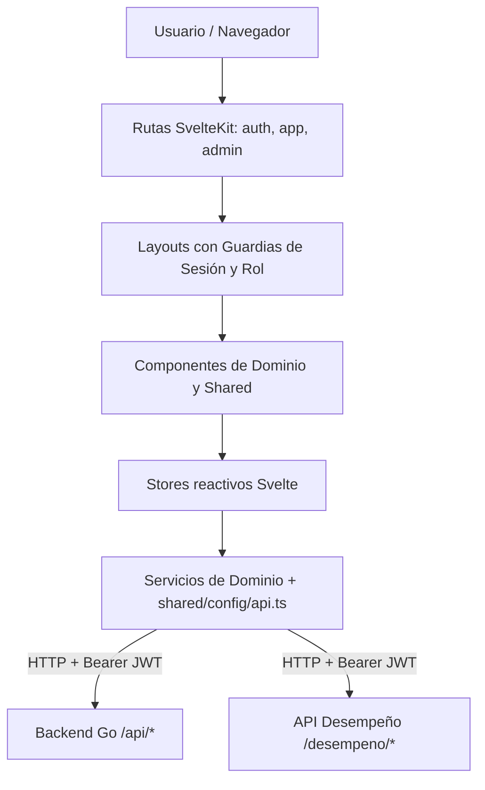

# Documentación Técnica – Frontend

Aplicación web para la gestión y solicitud de **permisos laborales** (`solicitud-permisos-v2`). Desarrollada con **SvelteKit 2**, **Svelte 5** (modo *runes*), **TypeScript** y **Tailwind CSS v4**, organizada bajo una **arquitectura orientada a dominios** (`src/lib/domains/`) y conectada a la API REST en Go (y a un servicio externo de desempeño).

---

## Índice

1. [Stack](#1-stack)
2. [Arquitectura](#2-arquitectura)
3. [Estructura de carpetas](#3-estructura-de-carpetas)
4. [Principios SOLID y diseño modular](#4-principios-solid-y-diseño-modular)
5. [Rutas y layouts](#5-rutas-y-layouts)
6. [Dominios y módulos](#6-dominios-y-módulos)
7. [Estado y comunicación con API](#7-estado-y-comunicación-con-api)
8. [Autenticación y control de acceso](#8-autenticación-y-control-de-acceso)
9. [Variables de entorno](#9-variables-de-entorno)
10. [Comandos](#10-comandos)
11. [Despliegue](#11-despliegue)
12. [Puntos de mejora y riesgos](#12-puntos-de-mejora-y-riesgos)

---

## 1. Stack

| Tecnología | Versión | Uso |
|---|---|---|
| SvelteKit | `^2.57.0` (`@sveltejs/adapter-auto`) | Enrutamiento basado en archivos, layouts y build |
| Svelte | `^5.55.2` (modo `runes: true`) | UI reactiva con `$state`, `$derived`, `$effect`, `$props` |
| TypeScript | `^6.0.2` | Tipado estático en servicios, stores y componentes |
| Vite | `^8.0.7` | Bundler y servidor de desarrollo/preview |
| Tailwind CSS | `^4.2.2` (`@tailwindcss/vite`, `@tailwindcss/forms`) | Estilos utilitarios |
| GSAP | `^3.15.0` | Animaciones y transiciones |
| `@tanstack/svelte-virtual` | `^3.13.24` | Virtualización de listas largas |
| `@hugeicons/svelte` | `^1.1.2` | Iconografía |
| `date-holidays` | `^3.29.0` | Soporte de festivos en cliente |
| `svelte-french-toast` | `^1.2.0` | Notificaciones tipo *toast* |
| Vitest + Playwright | `^4.1.3` / `^1.59.1` | Pruebas unitarias y de navegador |

---

## 2. Arquitectura



### Flujo de capas

1. **Rutas y Layouts (`src/routes/`)**: Separan las vistas públicas (`(auth)`), el portal de empleados (`(app)`) y el panel administrativo (`admin`). Los layouts ejecutan `authStore.checkAuth()` y redirigen según autenticación y rol.
2. **Dominios (`src/lib/domains/`)**: Cada módulo funcional (`auth`, `dashboard`, `permisos`, `solicitudes`, `admin`) agrupa sus propios `components/`, `services/`, `stores/`, `types/` y `utils/`, exponiendo su API pública mediante un `index.ts`.
3. **Capa compartida (`src/lib/shared/`)**: Centraliza `config/api.ts`, componentes reutilizables (`AppHeader`, `AdminSidebar`, `LoadingOverlay`, `SolicitudModal`, etc.), `stores/ui.store.ts` y utilidades (`jwt.ts`, `dates.ts`, `validators.ts`, `random-id.ts`).

---

## 3. Estructura de carpetas

```text
src/
├── app.html                           # Plantilla HTML base
├── app.d.ts                           # Tipos globales de SvelteKit
├── routes/
│   ├── +layout.svelte                 # Layout raíz (CSS, fuentes, Toaster, LoadingOverlay)
│   ├── +page.svelte                   # Ruta raíz
│   ├── layout.css                     # Estilos globales / Tailwind
│   ├── (auth)/
│   │   ├── +layout.svelte             # Layout de autenticación
│   │   └── login/+page.svelte         # Pantalla de inicio de sesión
│   ├── (app)/                         # Portal de empleados
│   │   ├── +layout.svelte             # Guardia empleado (redirige admins a /admin/general)
│   │   ├── dashboard/+page.svelte     # Panel principal del empleado
│   │   ├── permisos/+page.svelte      # Creación de solicitudes de permiso
│   │   ├── solicitudes/+page.svelte   # Historial y estado de solicitudes
│   │   └── reglamento/+page.svelte    # Visualización del Reglamento Interno de Trabajo
│   └── admin/                         # Panel administrativo
│       ├── +layout.svelte             # Guardia admin (restringe 7654 a /admin/ads)
│       ├── +page.svelte
│       ├── general/+page.svelte       # Gestión general de solicitudes y estadísticas
│       ├── fechas/+page.svelte        # Configuración de fechas habilitadas y cierres
│       ├── extemporaneos/+page.svelte # Registro de permisos extemporáneos
│       ├── historico/+page.svelte     # Consulta histórica de solicitudes
│       └── ads/+page.svelte           # Gestión de anuncios de video y documentos
└── lib/
    ├── domains/
    │   ├── auth/                      # Login, store de sesión, JWT y permisos de rol
    │   ├── dashboard/                 # Stats, acciones rápidas y bienvenida
    │   ├── permisos/                  # Tipos, creación y adjuntos de permisos
    │   ├── solicitudes/               # Historial, archivos y solicitudes del usuario
    │   └── admin/                     # Servicios y stores del panel administrativo
    └── shared/
        ├── config/api.ts              # Cliente HTTP base y endpoints tipados
        ├── components/                # UI compartida (headers, sidebar, modales, cards)
        ├── stores/ui.store.ts         # Estado global de UI (ej. ocultarHeaderYNavbar)
        └── utils/                     # jwt.ts, dates.ts, validators.ts, random-id.ts
```

---

## 4. Principios SOLID y diseño modular

| Principio | Aplicación en el proyecto |
|---|---|
| **S** (Responsabilidad única) | Separación estricta entre `types/`, `services/` (HTTP), `stores/` (estado reactivo) y `components/` (presentación) dentro de cada dominio. |
| **O** (Abierto/Cerrado) | Nuevas funcionalidades se añaden como nuevos dominios bajo `src/lib/domains/<modulo>` con su `index.ts` sin modificar otros dominios. |
| **L / I** (Sustitución / Segregación) | Cada dominio exporta interfaces específicas (`AuthState`, `Permiso`, `Solicitud`, `AdminStats`) evitando objetos monolíticos. |
| **D** (Inversión de dependencias) | Los componentes consumen stores y servicios exportados por el barril (`index.ts`) del dominio, desacoplándose de `fetch` y `localStorage`. |

---

## 5. Rutas y layouts

| Grupo / Ruta | Acceso permitido | Comportamiento de guardia |
|---|---|---|
| `/login` | Público | Formulario de ingreso (`LoginForm`) |
| `/(app)/dashboard` | Empleados | Si es admin redirige a `/admin/general`; si no hay sesión, a `/login` |
| `/(app)/permisos` | Empleados | Formulario de solicitud de permisos y carga de soportes |
| `/(app)/solicitudes` | Empleados | Listado e historial de solicitudes del usuario |
| `/(app)/reglamento` | Empleados | Acceso al PDF `RG-RH 01 Reglamento Interno de Trabajo.pdf` |
| `/admin/general` | Administradores | Si no es admin redirige a `/dashboard` |
| `/admin/fechas` | Administradores | Gestión de fechas habilitadas, switch semanal y cierres |
| `/admin/extemporaneos` | Administradores | Creación de permisos extemporáneos |
| `/admin/historico` | Administradores | Búsqueda y revisión histórica |
| `/admin/ads` | Administradores (única ruta para `7654`) | El usuario `7654` (`se_comunicaciones`) es redirigido aquí desde cualquier otra ruta `/admin/*` |

---

## 6. Dominios y módulos

- **`auth`**: `authStore` (login, logout, `checkAuth`), `permissions.ts` (`esAdmin`, `obtenerAreaForzada`, `rutaInicialPorRol`) y componentes de login (`LoginForm`, `InputField`, `PasswordInput`, `SubmitButton`).
- **`dashboard`**: `WelcomeHeader`, `StatsGrid`, `QuickActions`, `dashboard.service.ts` y `dashboard.store.ts` (resumen de solicitudes y eficiencia/desempeño).
- **`permisos`**: `permisos.service.ts` y `permisos.store.ts` para consultar tipos de novedad/subpolíticas y enviar solicitudes con adjuntos.
- **`solicitudes`**: `solicitudes.service.ts`, `archivos.service.ts` y `solicitudes.store.ts` para historial, detalle y descarga de evidencias.
- **`admin`**: `admin.service.ts` y `admin.store.ts` para aprobación/rechazo, respuestas rápidas, estadísticas semanales, anuncios y fechas.

---

## 7. Estado y comunicación con API

### Cliente HTTP (`src/lib/shared/config/api.ts`)
- Usa `fetch` nativo apuntando a `API_BASE_URL` (`VITE_API_BASE_URL`) y `API_DESEMPENO_URL` (`VITE_API_DESEMPENO_URL`).
- Adjunta `Authorization: Bearer <token>` leído desde `localStorage.getItem('token')`.

### Almacenamiento de sesión (`auth.store.ts`)
- Claves en `localStorage`: `token`, `user` (JSON) y `token_expires_at`.
- Al cerrar sesión (`limpiarSesion`), limpia `localStorage`, `sessionStorage`, cookies del dominio y bases `IndexedDB`.

---

## 8. Autenticación y control de acceso

1. El usuario envía `codigo` (opcional para Mantenimiento y Vía-Vigilantes) y `cedula` en `/login`.
2. `authStore.login` llama a `POST /api/auth/login`, extrae la expiración del JWT (`$lib/shared/utils/jwt.ts`) y persiste la sesión.
3. En cada navegación protegida, los layouts `(app)/+layout.svelte` y `admin/+layout.svelte` ejecutan `authStore.checkAuth()` y validan:
   - `esAdmin(usuario)`: verifica si `usuario.codigo` pertenece a `['9999', '0000', '1303', '0101', '7654', '6666', '5090']`.
   - `rutaInicialPorRol(usuario)`: envía a `/admin/ads` si es `7654` (`se_comunicaciones`), `/admin/general` para otros admins, o `/dashboard` para empleados.
   - `obtenerAreaForzada(usuario)`: mapea `se_operaciones`, `se_mantenimiento` y `se_via_vigilantes` al área correspondiente en el panel.

---

## 9. Variables de entorno

| Variable | Uso | Defecto |
|---|---|---|
| `VITE_API_BASE_URL` | URL base del backend en Go | `http://localhost:8080` |
| `VITE_API_DESEMPENO_URL` | URL del microservicio de desempeño (`/desempeno/cedula/:cedula`) | `http://localhost:3040` |

Plantilla base en [`.env.example`](../.env.example).

---

## 10. Comandos

```bash
# Instalar dependencias
pnpm install

# Servidor de desarrollo (Vite)
pnpm dev

# Verificación de tipos y Svelte
pnpm check

# Compilar para producción
pnpm build

# Previsualizar build en puerto 3047 (usado en producción)
pnpm preview

# Pruebas unitarias
pnpm test
```

---

## 11. Despliegue

El workflow [`.github/workflows/ci-cd.yml`](../.github/workflows/ci-cd.yml) automatiza el despliegue al hacer push a `main`:

1. Instala dependencias con `pnpm install` (Node.js 20, pnpm 9).
2. Genera `.env` con `VITE_API_BASE_URL` desde GitHub Secrets.
3. Compila con `pnpm run build`.
4. Inicia/reinicia la aplicación con **PM2** bajo el nombre `solicitud_permisos_front` ejecutando `pnpm run preview` en el puerto **3047** (`--host 0.0.0.0 --port 3047`).

---

## 12. Puntos de mejora y riesgos

| Prioridad | Tema | Observación / Acción sugerida |
|---|---|---|
| **Alta** | `vite preview` en producción | En [`ci-cd.yml`](../.github/workflows/ci-cd.yml) se levanta el frontend con `pnpm run preview` (`vite preview --port 3047`), pensado para pruebas locales y no como servidor de producción; considerar `@sveltejs/adapter-node` o servir archivos estáticos con Nginx. |
| **Alta** | Token en `localStorage` | Guardar el JWT en `localStorage` expone la sesión ante posibles ataques XSS; evaluar cookies `HttpOnly` o políticas CSP estrictas. |
| **Media** | Roles y códigos admin en cliente | `CODIGOS_ADMIN` está replicado en [`permissions.ts`](../src/lib/domains/auth/utils/permissions.ts); la autorización real debe depender del backend y venir declarada como rol/permisos en el JWT o `/api/me`. |
| **Media** | `VITE_API_DESEMPENO_URL` ausente en `.env.example` y CI/CD | `api.ts` usa `VITE_API_DESEMPENO_URL` (por defecto `http://localhost:3040`), pero no está declarada en `.env.example` ni inyectada en `ci-cd.yml`. |
| **Media** | Logs de depuración en producción | Existen `console.log('[AUTH DEBUG] ...')` en `auth.store.ts` que imprimen datos de login; eliminarlos o condicionarlos a `import.meta.env.DEV`. |
| **Baja** | Pruebas de ejemplo únicamente | Los tests actuales en `src/lib/vitest-examples/` son de plantilla; agregar pruebas para `permissions.ts`, `jwt.ts` y stores críticos. |
